<div align="center">

# NETRĀ (नेत्र)

### Privacy-preserving AI growth copilot for Indian kirana merchants

**Network intelligence without merchant exposure.**

[](https://www.python.org/)
[](https://fastapi.tiangolo.com/)
[](https://react.dev/)
[](https://vitejs.dev/)
[](https://tailwindcss.com/)
[](https://n8n.io/)
[](LICENSE)

[Live demo](https://netra-ai-live.pages.dev) · [Architecture](docs/ARCHITECTURE.md) · [Privacy model](docs/PRIVACY_MODEL.md) · [Threat model](docs/THREAT_MODEL.md) · [Pitch deck](docs/NETRA_PITCH_DECK.pdf)

</div>

---

## Overview

Kirana stores carry most of India's grocery retail, yet each one runs blind to what is happening in its own micro-market. Pooling transaction data across merchants could fix that, but a naive assistant creates a different problem:

> *"The shop 200 m from you sells cold drinks for ₹35, so charge ₹34."*

That sentence is competitor surveillance, it invites a price war, and repeated across a neighbourhood it turns into algorithmic price coordination.

NETRĀ gives merchants market-level intelligence (demand momentum, category price ranges, cash-flow forecasts, festival stocking alerts, inventory guidance) through a web dashboard, a WhatsApp-style copilot and a Paytm Soundbox voice channel. Every market signal goes through a privacy boundary first:

- Signals are computed only over cohorts of **10 or more merchants**. Smaller cohorts are widened (1 km → 3 km → 5 km) or suppressed.
- Price context is published only as **P25 / median / P75 ranges**. No individual store price is ever returned.
- A two-stage **competition-safety guard** screens both what the merchant asks and what the LLM answers. It blocks competitor probes, price-matching and price-cut-to-benchmark advice.
- Every allowed, blocked or suppressed decision is written to an **append-only audit log**.

The default recommendation is always to **grow basket size** (bundles, stocking, placement, timing). NETRĀ never tells a merchant to cut a unit price.

---

## Key features

| Module | What it does | Where |
| :--- | :--- | :--- |
| **Trade Radar** | Category demand momentum in the merchant's cluster, compared with the merchant's own activity | `analytics/trade_radar.py` |
| **Price Pulse** | P25 / median / P75 category ticket-size ranges with bundling advice, cohort-gated | `analytics/price_pulse.py` |
| **Cash Flow Prophet** | 7-day inflow forecast fitted on the merchant's **own** history (OLS trend + shrunk weekday seasonality, 80% bands) | `analytics/forecast_model.py` |
| **Festival Engine** | Walks a real festival calendar and raises T-minus stocking alerts inside each festival's prep window | `analytics/festival.py` |
| **Growth Missions** | Weekly tasks derived from the gap between the merchant's category mix and the cohort-approved cluster mix | `analytics/growth_missions.py` |
| **Inventory Intelligence** | Dead-stock bundles, depletion forecasts, 1-tap WhatsApp purchase orders, POS barcode simulation | `analytics/inventory_engine.py` |
| **WhatsApp Copilot** | Free-form chat in 7 languages, guarded on input and output, grounded only in aggregates | `api/v1/recommendations.py` |
| **Knowledge graph** | Cognee-style property graph of merchants, cohorts and decisions, with a feedback loop | `integrations/cognee_adapter.py` |
| **Security Sentinel** | Live view of the append-only audit stream | `api/v1/security.py` |
| **Attack Simulator** | Runs four adversarial scenarios against the privacy and safety layers | `api/v1/simulator.py` |
| **n8n Hub** | Four importable n8n workflows plus a dashboard to trigger and inspect them | `n8n/workflows/` |

**Languages:** English, Hindi (हिंदी), Tamil (தமிழ்), Telugu (తెలుగు), Kannada (ಕನ್ನಡ), Marathi (मराठी) and Bengali (বাংলা). The UI is fully translated (`frontend/src/i18n/translations.js`), and the copilot, LLM prompts and Soundbox scripts are localised as well.

---

## System architecture

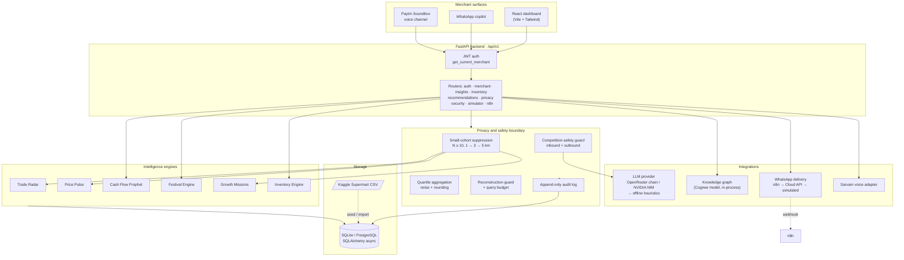

### Request lifecycle: a copilot question

The copilot endpoint shows every layer working together:

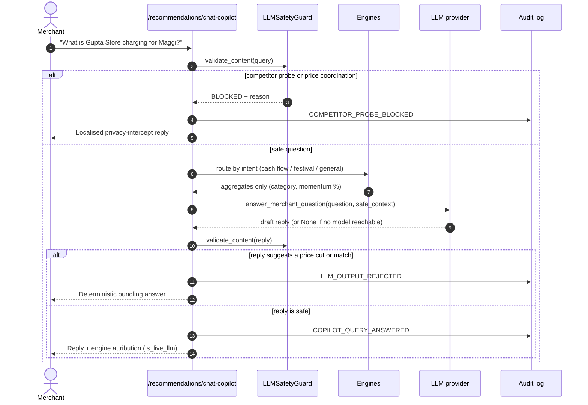

The model never receives raw transactions or another merchant's figures, so it has nothing private to leak. The response also reports which engine actually answered, so the UI never claims an AI answered when the rules engine did.

---

## The privacy model

### The 4-merchant problem

If four stores share a 1 km radius and NETRĀ publishes their average, any one of them can subtract its own figures and recover a neighbour's:

$$\text{Rival revenue} = 4 \times \overline{X} - (X_1 + X_2 + X_3)$$

### Defence layers

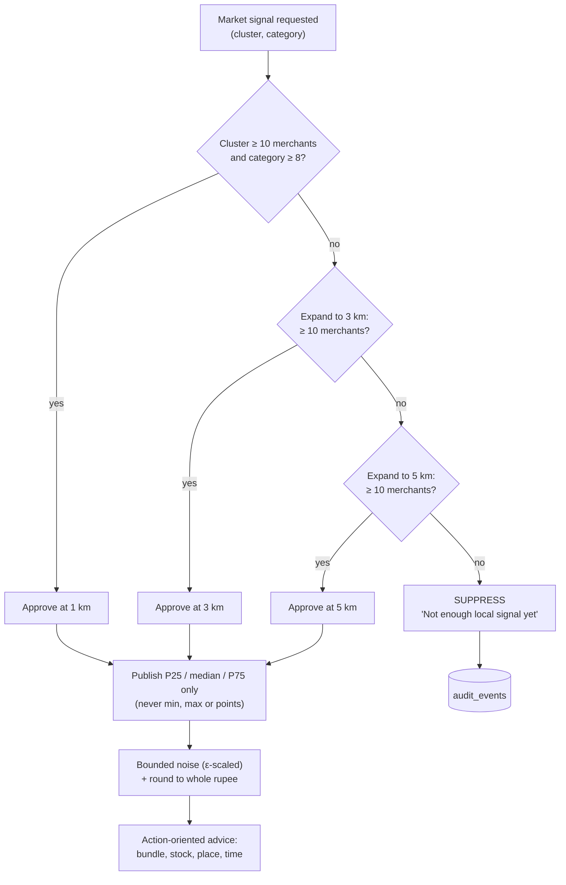

| Layer | Rule | Implementation |
| :--- | :--- | :--- |
| Cohort threshold | `MIN_MARKET_MERCHANTS = 10`, `MIN_CATEGORY_MERCHANTS = 8` | `privacy/policies.py`, `privacy/suppression.py` |
| Adaptive expansion | 1 km → 3 km → 5 km, then suppress | `privacy/geographic_privacy.py` |
| Quartile-only output | Median, P25, P75. Never min, max or individual values | `privacy/aggregation.py` |
| Noise and rounding | Uniform noise scaled by `PRIVACY_NOISE_EPSILON × median`, rounded to ₹1 | `privacy/aggregation.py` |
| Differencing defence | Rejects same-category queries whose radius differs by less than 0.3 km within 60 s, and bursts of 6+ | `privacy/reconstruction_guard.py` |
| Query budget | 15 sensitive queries per merchant per sliding 24 h window | `privacy/query_budget.py` |
| Server-side identity | Merchant identity comes only from the JWT `sub` claim, never from the request body | `auth/dependencies.py` |

See [docs/PRIVACY_MODEL.md](docs/PRIVACY_MODEL.md) for the formal treatment and [Implementation status](#implementation-status) for which layers are enforced on live endpoints today.

---

## Competition-safety guard

`LLMSafetyGuard` (`backend/app/recommendations/llm_guard.py`) detects **intent**, not a list of shop names, so it catches stores it has never seen.

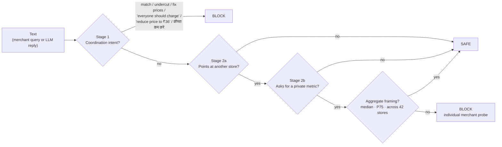

- **Stage 1** blocks coordination language on its own. Aggregate framing never excuses it.
- **Stage 2** blocks only the **combination** of a competitor reference ("the shop next door", "Gupta General Store", "bagal wali dukaan") and a private metric ("price", "kitna", "revenue"). Either one alone is fine: *"what is my cash flow"* and *"nearby demand is up"* both pass.
- The guard runs on inbound queries, on LLM output and on stored recommendations before they are served.

---

## Intelligence engines

### Cash Flow Prophet

A small, explainable time-series model fitted per merchant on that merchant's own transactions. No privacy gate is needed here because the model only ever sees the caller's data.

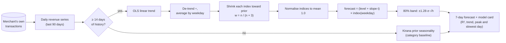

The module ships a self-check (`python -m backend.app.analytics.forecast_model`). On a synthetic 90-day series it recovers the weekly shape with R² ≈ 0.98.

### Other engines

- **Trade Radar** reads cohort-approved `market_aggregates`, drops suppressed categories, and ranks opportunities by comparing cluster velocity with the merchant's own category activity.
- **Price Pulse** returns the cluster's quartile range for a category plus a bundling recommendation. A suppressed cohort returns only the suppression message.
- **Festival Engine** computes days remaining against real dates (Holi, Navratri, Eid-ul-Fitr, Diwali), rolls past dates into next year, and marks alerts inside each festival's prep window (`impact_days_prior`) as urgent.
- **Growth Missions** turns the largest positive gap between cluster share and the merchant's share into a weekly task. It skips categories the merchant has already accepted in the knowledge graph.
- **Inventory Engine** seeds a 12-SKU kirana catalogue per merchant. It flags stock older than 21 days for bundle liquidation (12% bundle discount with margin preserved), estimates depletion hours, and drafts WhatsApp purchase orders.

---

## Merchant knowledge graph

`integrations/cognee_adapter.py` implements Cognee's memory **model** locally: a labelled property graph with typed nodes and edges. There is no network dependency, and every edge can be inspected. At startup the graph is hydrated from the merchants table (203 merchants → 210 nodes, 609 edges on the demo dataset).

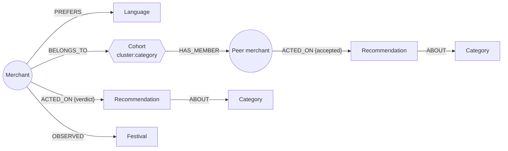

**Reinforcement loop:** when a merchant accepts or dismisses a recommendation (`POST /recommendations/{id}/action`), the outcome becomes an `ACTED_ON` edge. Cohort recommendations come from walking *Merchant → Cohort → Peer → accepted Recommendation → Category*, which is collaborative filtering expressed as graph traversal. As a result, a merchant's next suggestions and their peers' suggestions change based on what actually worked.

---

## Messaging and orchestration

NETRĀ never calls WhatsApp directly from business logic. It builds a channel-agnostic envelope, and `WhatsAppDeliveryService` chooses the last mile automatically:

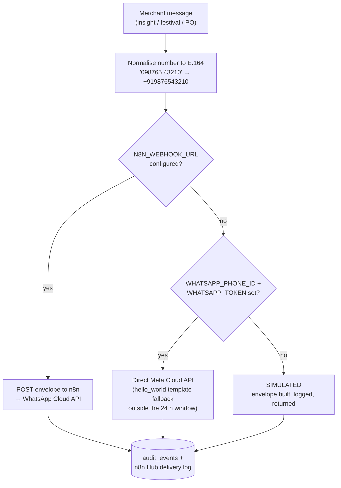

### n8n workflows (`n8n/workflows/`)

| Workflow | Trigger | Flow |
| :--- | :--- | :--- |
| `1_daily_eod_soundbox.json` | Cron, 10:00 PM daily | Fetch 7-day cash flow → format Indic speech → Sarvam TTS → Soundbox |
| `2_festival_t14_inventory_tender.json` | Cron, Monday 9:00 AM | Fetch festivals → T-14 check → WhatsApp tender message → dispatch |
| `3_privacy_sentinel_alert.json` | Webhook | Cohort < 10? → log suppression, or proceed with safe aggregate |
| `4_whatsapp_merchant_delivery.json` | Webhook from NETRĀ | Format payload → credentials present? → Cloud API → report back to `/n8n/delivery-callback` |

Import them into n8n. To deliver real messages, point `N8N_WEBHOOK_URL` at the production URL of workflow 4.

---

## Data model

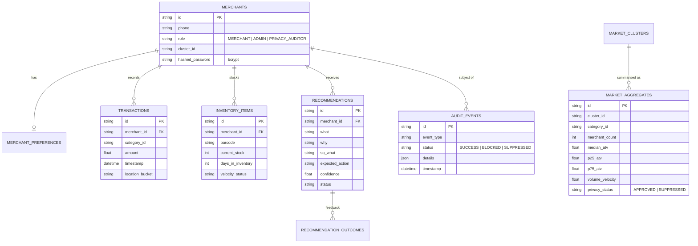

Analytics engines read `market_aggregates` (cohort summaries), never another merchant's raw `transactions`. The only raw rows an engine reads belong to the calling merchant.

---

## Data pipeline

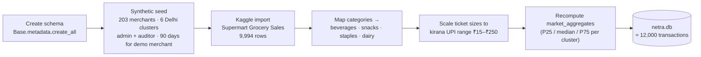

- **Source:** [Supermart Grocery Sales — Retail Analytics Dataset](https://www.kaggle.com/datasets/mohamedharris/supermart-grocery-sales-retail-analytics-dataset) (Mohamed Harris), shipped as `data/supermart_raw.csv`.
- **Clusters:** Lajpat Nagar, Karol Bagh, Chandni Chowk, Indirapuram and Rohini, plus a deliberately tiny `isolated_rural_cluster` (4 stores). It stays below 10 even at 5 km so suppression can be demonstrated.
- The schema and synthetic merchants must exist **before** the Kaggle import runs. `run.py` and `run_demo.ps1` handle that order for you.

---

## Frontend

React 18 + Vite 5 + Tailwind 3 with a wine (`#722F37`) and cream (`#FFF8F0`) design system. It has five tabs: **Dashboard**, **n8n Hub**, **Privacy Center**, **Security Sentinel** and **Attack Simulator**. Supporting modals include the Soundbox device, WhatsApp simulator, cluster privacy map, inventory hub, knowledge-graph explorer and credit statement.

On phones the layout changes rather than just shrinking: bottom sheets replace centred modals, a tab bar replaces the navbar, and rails become swipeable (`hooks/useViewport.js`).

### Offline edge mode

`services/api.js` wraps every call in `fetchWithAuth`, so the UI degrades gracefully instead of breaking:

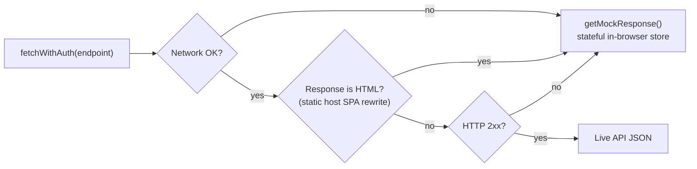

This is why the static deployment at [netra-ai-live.pages.dev](https://netra-ai-live.pages.dev) works with no backend: it serves recorded responses from `services/mockStore.js`. Run the backend locally to see live data.

---

## Getting started

### Prerequisites

- Python 3.11 (CI and Render use 3.11)
- Node.js 18+
- Optional: [`cloudflared`](https://developers.cloudflare.com/cloudflare-one/connections/connect-networks/downloads/) for a public phone URL

### One command

```bash
python run.py              # backend + frontend + public HTTPS tunnel + QR code
python run.py --no-tunnel  # local only
python run.py --reseed     # rebuild netra.db from scratch
```

`run.py` installs missing Python and npm dependencies, builds `netra.db` on first run (synthetic seed, then Kaggle import), frees ports 3000 and 8000, starts both servers, and opens a Cloudflare tunnel. It prints a QR code using a dependency-free encoder (`qr.py`), so a phone on mobile data can open the app. Press `Ctrl+C` to stop everything.

On Windows you can also use the PowerShell launcher:

```powershell
.\scripts\run_demo.ps1            # local
.\scripts\run_demo.ps1 -Tunnel    # + public URL
.\scripts\run_demo.ps1 -Reseed    # rebuild database
```

| URL | What |
| :--- | :--- |
| http://localhost:3000 | Web app (Vite proxies `/api` to the backend, so everything is same-origin) |
| http://localhost:8000/docs | Interactive OpenAPI docs |

### Manual setup

```bash
# Backend
python -m venv .venv && source .venv/bin/activate   # Windows: .venv\Scripts\activate
pip install -r backend/requirements.txt
export PYTHONPATH=.                                  # Windows: $env:PYTHONPATH="."
uvicorn backend.app.main:app --port 8000             # creates tables and seeds in DEMO_MODE

# Optional: load the Kaggle dataset (after the first start has seeded merchants)
python backend/app/scripts/import_kaggle_data.py --limit 11500

# Frontend
npm --prefix frontend install
npm --prefix frontend run dev -- --port 3000
```

### Demo accounts

The UI signs in automatically as the demo merchant through `GET /auth/demo-token`. For the API:

| Role | Phone | Password |
| :--- | :--- | :--- |
| Merchant (Sanjeev Kumar, Lajpat Nagar) | `9876543210` | `ramesh123` |
| Admin | `9999999999` | `admin123` |
| Privacy auditor | `9888888888` | `auditor123` |
| Any synthetic merchant | (seeded) | `kirana123` |

These credentials are for the local demo only.

---

## Configuration

Copy `.env.example` to `.env`. Every key is optional, and the app runs fully offline with defaults.

| Variable | Default | Purpose |
| :--- | :--- | :--- |
| `DEMO_MODE` | `true` | Auto-create tables and seed on startup |
| `DATABASE_URL` | `sqlite+aiosqlite:///./netra.db` | Any SQLAlchemy async URL (`/tmp/netra.db` on Vercel) |
| `SECRET_KEY` | demo value | JWT signing key. **Change it for any shared deployment** |
| `ACCESS_TOKEN_EXPIRE_MINUTES` | `1440` | JWT lifetime |
| `MIN_MARKET_MERCHANTS` / `MIN_CATEGORY_MERCHANTS` | `10` / `8` | Cohort thresholds |
| `MAX_SENSITIVE_QUERIES_PER_WINDOW` / `QUERY_WINDOW_HOURS` | `15` / `24` | Query budget |
| `PRIVACY_NOISE_EPSILON` | `0.05` | Noise scale relative to the median |
| `OPENROUTER_API_KEY` | — | Enables the live LLM path |
| `OPENROUTER_MODEL` / `OPENROUTER_FALLBACK_MODELS` | Nemotron 3 Super → DeepSeek V4 Flash → Qwen 3.8 → Gemma 4 | Free-tier chain, ordered by measured reliability. The client falls through only on 429 or 5xx |
| `NVIDIA_API_KEY` / `NVIDIA_MODEL` | — / `meta/llama-3.3-70b-instruct` | Alternative provider when OpenRouter is not set |
| `N8N_WEBHOOK_URL` | local placeholder | n8n webhook for real WhatsApp delivery |
| `WHATSAPP_PHONE_ID` / `WHATSAPP_TOKEN` | — | Direct Meta Cloud API delivery without n8n |
| `CLOUDFLARE_TUNNEL_NAME` / `CLOUDFLARE_TUNNEL_HOSTNAME` | — | Named tunnel with a stable URL (`run.py`) |
| `VITE_API_BASE` (frontend) | `""` | API origin when the frontend is hosted separately |

With no LLM key, NETRĀ uses deterministic heuristics and labels its answers as such (`is_live_llm: false`).

---

## API reference

All routes are prefixed with `/api/v1`. Full schemas are at `/docs`.

<details>
<summary><b>Endpoint list</b></summary>

| Method | Path | Description |
| :--- | :--- | :--- |
| POST | `/auth/login` | Phone + password → JWT (failures are audited) |
| GET | `/auth/demo-token` | JWT for the demo merchant |
| GET | `/merchant/me` | Profile + knowledge-graph memory profile |
| PATCH | `/merchant/contact` | Change the merchant's WhatsApp number |
| POST | `/merchant/whatsapp/send` | Dispatch an alert via n8n / Cloud API / simulated |
| GET | `/merchant/knowledge-graph` | Graph neighbourhood, cohort suggestions, profile |
| GET | `/merchant/voice-signal` | Localised Soundbox speech payload |
| POST | `/merchant/simulate-payment` | Simulated Soundbox UPI payment |
| GET | `/merchant/credit-statement` | Illustrative underwriting statement |
| GET | `/insights/trade-radar` | Cohort-gated demand signals |
| GET | `/insights/price-pulse?category=` | Cohort-gated quartile range |
| GET | `/insights/cashflow` | 7-day fitted forecast + model card |
| GET | `/insights/festival` | Next festivals with prep-window flags |
| GET | `/insights/growth-missions` | Gap-derived weekly missions |
| GET | `/inventory/overview` · `/items` · `/dead-stock` · `/reorder-alerts` · `/cluster-pool` | Inventory intelligence |
| POST | `/inventory/simulate-pos-sale` | POS barcode scan → stock update + Soundbox line |
| POST | `/inventory/dispatch-po` | WhatsApp purchase order to a distributor |
| GET | `/recommendations` | Pending recommendations, re-screened by the guard |
| POST | `/recommendations/generate-llm` | LLM growth insight in the chosen language |
| POST | `/recommendations/{id}/action` | Record feedback → audit + knowledge-graph edge |
| POST | `/recommendations/chat-copilot` | Guarded conversational copilot |
| GET | `/privacy/policy` · `/privacy/budget` | Active policy and remaining query budget |
| GET | `/security/audit-events` | Audit stream |
| POST | `/simulator/run` | `small_cohort` · `competitor_price` · `reconstruction_diff` · `prompt_injection` |
| GET | `/n8n/info` · `/n8n/deliveries` | Workflow registry, delivery log |
| POST | `/n8n/trigger/eod` · `/festival` · `/privacy-sentinel` | Run a workflow in-process |
| POST | `/n8n/delivery-callback` | n8n reports delivery results here |
| GET | `/health` · `/ready` · `/metrics` | Health probes |

</details>

```bash
TOKEN=$(curl -s localhost:8000/api/v1/auth/demo-token | python -c "import sys,json;print(json.load(sys.stdin)['access_token'])")

curl -s -X POST localhost:8000/api/v1/recommendations/chat-copilot \
  -H "Authorization: Bearer $TOKEN" -H "Content-Type: application/json" \
  -d '{"query":"What is Gupta Store charging for Maggi?","lang":"en"}'
# → "safety_verdict": "BLOCKED"
```

---

## Testing

```bash
PYTHONPATH=. python -m pytest backend/tests/ -v
```

The suite covers **84 tests** across nine modules:

| Module | Covers |
| :--- | :--- |
| `test_privacy.py` | Cohort suppression, expansion, quartile output, query budget, differencing rejection |
| `test_competition_safety.py` | Competitor probes, coordination phrasing, price-cut-to-benchmark, aggregate-framing false positives |
| `test_forecast_model.py` | Seasonality recovery, horizon-widening bands, insufficient-history fallback |
| `test_analytics.py` | Trade Radar, Price Pulse, festivals, growth missions |
| `test_cognee_and_whatsapp.py` | Graph feedback loop, number normalisation, delivery modes |
| `test_inventory.py` | Dead stock, reorder alerts, POS sale, PO dispatch |
| `test_auth.py` | bcrypt hashing, JWT issue/decode, expired and invalid tokens |
| `test_api_endpoints.py`, `test_n8n.py` | End-to-end API behaviour |

Three modules also include runnable self-checks:

```bash
python -m backend.app.analytics.forecast_model
python -m backend.app.integrations.cognee_adapter
python -m backend.app.integrations.whatsapp_delivery
```

CI (`.github/workflows/ci.yml`) runs the backend suite and a production frontend build on every push and pull request to `main`.

---

## Deployment

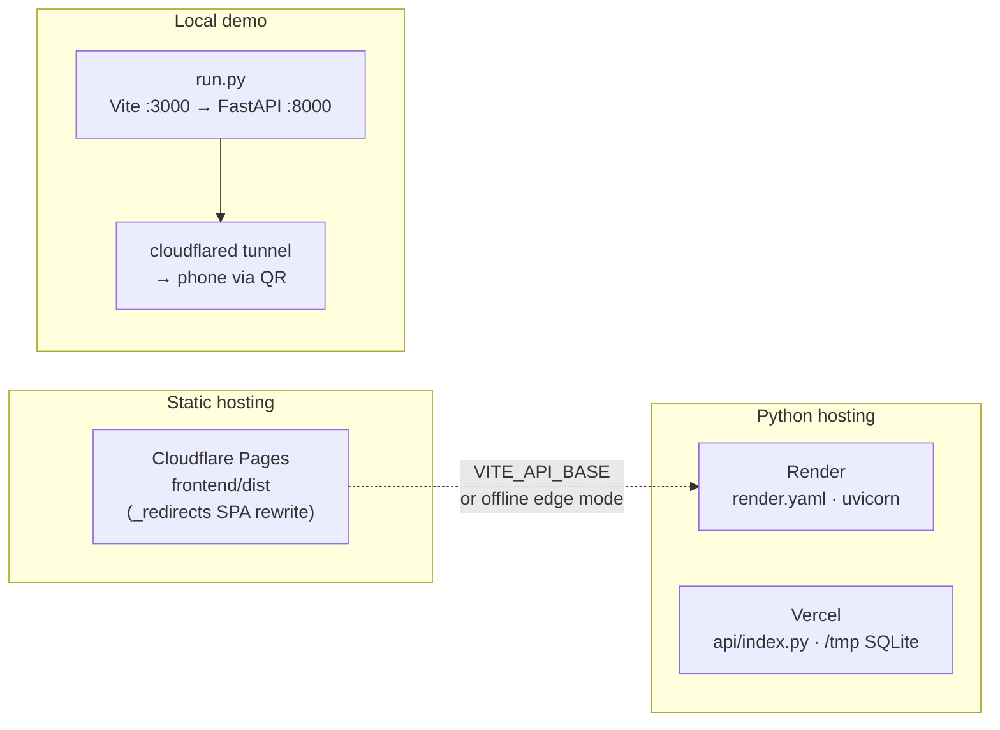

| Target | Config | Notes |
| :--- | :--- | :--- |
| Local | `run.py`, `scripts/run_demo.ps1` | Recommended path, with optional public tunnel |
| Render | `render.yaml` | Free web service, `DEMO_MODE=true`, Python 3.11.8 |
| Vercel | `vercel.json`, `api/index.py` | Serverless entry point. The DB lives in `/tmp` and is re-seeded on cold start by middleware |
| Cloudflare Pages | `frontend/public/_redirects` | Static frontend. Falls back to edge mode with no API |
| Docker Compose | `docker-compose.yml` | Experimental, see below |

---

## Implementation status

This project is a hackathon prototype. To keep the documentation honest, this section separates what is computed from what is staged.

**Computed from data**

- Cohort suppression and geographic expansion on Trade Radar, Price Pulse and Growth Missions
- Quartile aggregates recomputed from the Kaggle import
- Cash Flow Prophet, fitted per merchant
- Festival countdowns, from real dates
- Growth Missions, from real category-mix gaps
- The two-stage competition guard on copilot input, LLM output and stored recommendations
- Knowledge-graph feedback loop
- WhatsApp delivery through n8n or the Meta Cloud API, when configured
- Inventory state changes from POS sales
- Audit logging

**Staged or illustrative**

- Credit statement figures (score 820/900, limits)
- Cluster wholesale pool
- `/metrics` counters
- In-process n8n trigger step outputs
- Paytm payment events (simulated)
- Sarvam voice: localised scripts are prepared, but no TTS API call is made
- The Price Pulse merchant baseline (₹48)

**Known gaps**

- **Missing import (blocks startup).** `backend/app/auth/dependencies.py` uses `Optional` without `from typing import Optional`, so `backend.app.main` currently fails to import with `NameError` and the API test modules fail to collect. The 84-test figure above was measured with that one import supplied. Until it is fixed, the hosted frontend runs in offline edge mode.
- **Privacy layers not yet on live routes.** The query budget, noise aggregation and reconstruction guard are implemented and unit-tested. Today they run only in tests and the Attack Simulator, not on live insight endpoints.
- **No role checks on routes.** `require_role` exists but is not applied to any route, and `/security/audit-events` is unauthenticated.
- **Demo-merchant fallback.** Requests without a bearer token fall back to the demo merchant, which is a demo convenience.
- **Graph is not persisted.** The knowledge graph lives in process memory and is rebuilt from the merchants table on startup. Feedback edges do not survive a restart.
- **Docker Compose is broken.** The backend image copies `app/` but launches `backend.app.main`. The compose file also targets PostgreSQL through `asyncpg`, which is not in `requirements.txt`. The nginx frontend does not proxy `/api`.
- **Bash launcher seeds out of order.** `scripts/run_demo.sh` runs the Kaggle import before seeding merchants. Use `run.py` instead.

---

## Repository structure

```text
Netra-AI/
├── backend/
│   ├── app/
│   │   ├── analytics/        # Trade Radar, Price Pulse, Cash Flow model, Festival, Growth Missions, Inventory
│   │   ├── api/v1/           # Routers: auth, merchant, insights, inventory, recommendations,
│   │   │                     #          privacy, security, simulator, n8n, health
│   │   ├── auth/             # bcrypt, JWT, dependencies
│   │   ├── core/             # Settings (pydantic-settings), async engine
│   │   ├── data/             # Synthetic seeder
│   │   ├── integrations/     # LLM provider, knowledge graph, WhatsApp, Sarvam, Paytm, n8n
│   │   ├── models/           # SQLAlchemy models
│   │   ├── privacy/          # Policies, suppression, expansion, aggregation, budget, reconstruction guard
│   │   ├── recommendations/  # Recommendation service, feedback, LLM safety guard
│   │   ├── schemas/          # Pydantic schemas
│   │   ├── scripts/          # Kaggle importer
│   │   ├── security/         # Audit logger
│   │   └── main.py           # App factory, middleware, startup hydration
│   ├── tests/                # pytest suite
│   └── requirements.txt
├── frontend/
│   └── src/
│       ├── pages/            # Dashboard, N8nHub, PrivacyCenter, SecuritySentinel, AttackSimulator
│       ├── components/       # Cards, modals, ui/ primitives (Card, Sheet)
│       ├── services/         # API client + offline edge store
│       ├── i18n/             # 7-language translations
│       ├── hooks/            # useDismissable, useIsMobile
│       └── utils/            # Soundbox Web Audio engine
├── n8n/workflows/            # Importable n8n workflows
├── data/supermart_raw.csv    # Kaggle source dataset
├── docs/                     # Architecture, privacy model, threat model, pitch deck
├── api/index.py              # Vercel entry point
├── run.py                    # One-command launcher (+ tunnel + QR)
├── qr.py                     # Dependency-free QR encoder
├── scripts/                  # run_demo.ps1 / .sh, run_dev.sh
├── render.yaml · vercel.json · docker-compose.yml
└── .github/workflows/ci.yml
```

---

## Contributing and security

Contributions must preserve the core invariant. No code path, API response or prompt may expose an individual merchant's data, bypass cohort suppression, or recommend price matching or coordination. See [CONTRIBUTING.md](CONTRIBUTING.md) for setup and PR conventions, and [SECURITY.md](SECURITY.md) and [docs/THREAT_MODEL.md](docs/THREAT_MODEL.md) for the security model.

---

## License

Licensed under the [Apache License 2.0](LICENSE). Built for the Paytm Build for India AI Hackathon 2026.
